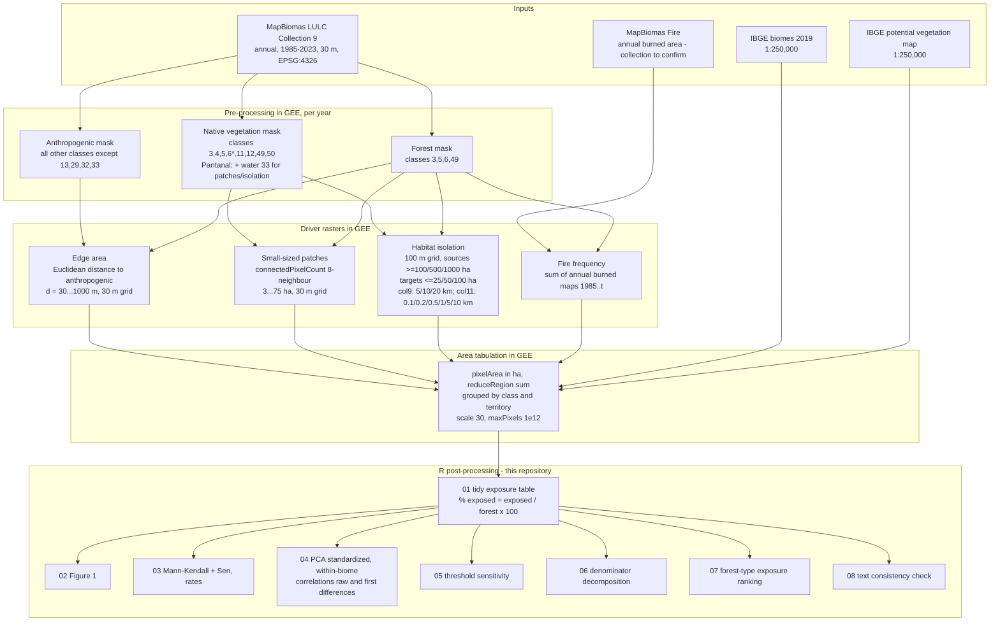

# Methodological workflow (Reviewer 2, comment 4.1)

This flowchart is the source for the new Supplementary Figure S1 (methods flowchart). It renders on GitHub.

`*` class 6 (floodable forest) is part of the native mask in the Amazon only, as coded.

Metrics recalculated **annually**: edge area, small-sized patches, habitat isolation (each year's
LULC map). **Cumulative**: fire frequency (fires from 1985 to year *t*, restricted to forest of year *t*).
